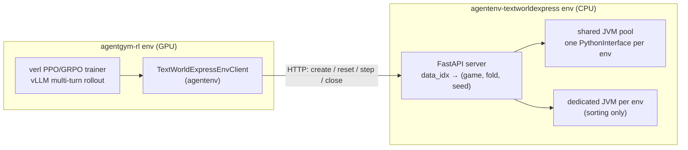

# AgentGym-RL × TextWorldExpress

Multi-turn reinforcement learning for LLM agents on **TextWorldExpress** text games, built on **AgentGym-RL**.

This repository extends [AgentGym-RL](https://github.com/WooooDyy/AgentGym-RL) with
[TextWorldExpress](https://github.com/cognitiveailab/TextWorldExpress) as a new training and
evaluation environment. TextWorldExpress is integrated the same way as the original environments
(BabyAI, SciWorld, TextCraft, ...), so you train on it with the same PPO/GRPO pipeline and the
same fixed-horizon or ScalingInter-RL schedules. The repository also ships a working quick-start
setup.

- [Background](#background)
- [What this project adds](#what-this-project-adds)
- [Quick start](#quick-start)
- [The TextWorldExpress environment](#the-textworldexpress-environment)
- [Repository layout](#repository-layout)
- [Acknowledgement and citation](#acknowledgement-and-citation)

## Background

### AgentGym-RL

[AgentGym-RL](https://arxiv.org/abs/2509.08755) (ICLR 2026 Oral) is a framework for training LLM agents on
**multi-turn** interactive decision making with RL. It has three decoupled parts:
- an **environment module**: [AgentGym](https://github.com/WooooDyy/AgentGym) environments served over a unified HTTP protocol;
- an **agent module**: multi-turn reasoning and acting;
- a **training module**: a fork of [verl](https://github.com/volcengine/verl) with multi-turn vLLM rollouts, correct loss masks for observation vs. action tokens, and PPO, GRPO, RLOO and REINFORCE++.

It also proposes **ScalingInter-RL**, which gradually lengthens the agent–environment interaction
horizon during training to balance exploration and exploitation.


### TextWorldExpress

[TextWorldExpress](https://arxiv.org/abs/2208.01174) is a fast reimplementation of popular text-game
benchmarks in Scala, reaching up to a million steps per second. Its eight games test instruction
following, commonsense, navigation and arithmetic reasoning. Every game is generated procedurally
from a seed, with separate train, dev and test seed sets:

| game | task |
|---|---|
| `cookingworld` | find the ingredients, follow the cookbook (slice/dice/chop, fry/roast/grill), prepare and eat the meal |
| `twc` (TextWorld Commonsense) | put household objects back where they belong |
| `coin` (Coin Collector) | explore the house and find the coin |
| `mapreader` | use a map to fetch a coin and bring it back to the box |
| `arithmetic` | solve a math problem, then put the matching object in the box |
| `sorting` | put objects in the box in order of increasing quantity (with units) |
| `simonsays` | do exactly what you are told |
| `peckingorder` | follow the instructions found in the environment |

## What this project adds

1. **A TextWorldExpress environment for AgentGym**
   ([`AgentGym/agentenv-textworldexpress`](https://github.com/Tian-Yizhou/AgentGym/tree/textworldexpress/agentenv-textworldexpress)).
   - It is a FastAPI server with the standard AgentGym protocol (`/create`, `/reset`, `/step`, `/observation`, `/close`) and serves all eight games at TextWorldExpress's default parameters.
   - The first observation states the game's goal, and every observation lists the currently valid actions.
   - Actions are matched exactly, after normalizing only case, whitespace and punctuation. There is no fuzzy matching.
   - The reward is TextWorldExpress's own normalized score, with an optional binary-success mode.
   - Errors come back as real HTTP errors instead of silently zeroing a rollout's reward.
2. **A server designed for RL-scale concurrency.**
   - The stock Python wrapper starts one Java process per game, about 0.7 s each. AgentGym-RL creates one environment per rollout sample per step (e.g. 16 × 8 = 128).
   - Here, all environments share a small JVM pool, one lightweight `PythonInterface` per environment: 64 environments are created in 0.09 s, and the pool sustains about 1,900 steps/s across 128 concurrent environments.
   - We also found that `sorting` keeps JVM-global state. Two copies of the same sorting game in one JVM corrupt each other, which happens on every GRPO step because a prompt's `n` samples play the same game. Sorting environments therefore get their own JVM.
3. **Reproducible, leak-free data splits.**
   - An item id `textworldexpress_<data_idx>` encodes the game, the fold and the seed. The folds are TextWorldExpress's own disjoint seed sets, which also use different object lists.
   - [`make_data.py`](https://github.com/Tian-Yizhou/AgentGym/tree/textworldexpress/agentenv-textworldexpress/scripts/make_data.py) generates the train, dev and test sets (1,600, 400 and 400 items by default) plus per-game category files, so evaluation reports results per game.
4. **End-to-end training and evaluation.**
   - The client `TextWorldExpressEnvClient` is registered in AgentGym-RL as `task_name=textworldexpress`.
   - There are launchers for AgentGym-RL (fixed horizon), ScalingInter-RL and evaluation. Their defaults are sized from measured token budgets (see the [table below](#game-statistics)), they detect the GPU count, and every setting can be overridden through environment variables.
5. **A working quick-start setup.**
   - `setup.sh` builds a consistent stack: torch 2.4.0, vLLM 0.6.3, flash-attn 2.7.3, transformers 4.51.3, datasets 3.x and trl 0.19.1. The upstream instructions resolve to conflicting versions and skip installing `agentenv`.
   - It creates the TextWorldExpress server env with Java from conda, so no system Java is needed, and generates the data.



## Quick start

**1. Clone and set up** on a Linux machine with an NVIDIA GPU and conda:

```sh
git clone --recursive https://github.com/Tian-Yizhou/AgentGym-RL.git
cd AgentGym-RL
bash setup.sh          # conda envs `agentgym-rl` + `agentenv-textworldexpress`, and the TextWorldExpress data
bash setup.sh model    # optional: Qwen2.5-7B-Instruct (~15 GB) -> AgentGym-RL/models/
```

If you cloned before the submodule moved to the fork, run `git submodule sync && git submodule update --init`.

**2. Start the environment server.** Keep it running; a CPU is enough:

```sh
conda activate agentenv-textworldexpress
textworldexpress --host 127.0.0.1 --port 36005
```

**3. Train**, from the repo root:

```sh
conda activate agentgym-rl
bash examples/train/AgentGym-RL/textworldexpress_train.sh       # fixed horizon (30 rounds)
bash examples/train/ScalingInter-RL/textworldexpress_train.sh   # horizon 10 -> 20 -> 30
```

Settings are environment variables, for example:

```sh
MODEL_PATH=models/Qwen2.5-3B-Instruct N_GPUS=4 ROUNDS=20 TOTAL_EPOCHS=5 \
  bash examples/train/AgentGym-RL/textworldexpress_train.sh
```

The other knobs are `ENV_SERVER_URL`, `TRAIN_BATCH_SIZE`, `ROLLOUT_N`, `LR`, `KL_COEF`, `MAX_RESPONSE_LENGTH`,
`MAX_TOKENS`, `TOTAL_TRAINING_STEPS`, `SAVE_FREQ`, `EXP_NAME` and `WANDB_MODE` (default `offline`); see the
script headers. Checkpoints and rollout logs go to `AgentGym-RL/saves/<exp_name>/`.

**4. Evaluate** on the test fold (or the dev fold with `EVAL_SET=textworldexpress_dev`):

```sh
CKPT_PATH=saves/<exp_name>/global_step_<N>/actor bash examples/eval/textworldexpress_eval.sh   # trained checkpoint
MODEL_PATH=models/Qwen2.5-7B-Instruct bash examples/eval/textworldexpress_eval.sh            # baseline
```

The output reports `Avg` (mean score) and `Pass` for all games and for each game. `Pass` counts any
positive score, so the success rate is the fraction of episodes with score 1.0; the per-item rewards
are in the eval log directory.

## The TextWorldExpress environment

**What the agent sees.** The first observation of a TWC game:

```
Your task is to pick up objects, then place them in their usual locations in the environment.

You are in the bedroom. In one part of the room you see a dressing table, that has nothing on it. [...]
In another part of the room you see a clean blue socks.
To the North you see the bathroom. To the West you see the corridor.

Available actions: ["inventory", "look around", "move north", "move west", "open chest of drawers", "open wardrobe", "take clean blue socks"]
```

The agent answers in a `Thought: ... Action: <one available action>` format.

**Reward.** The reward is TextWorldExpress's normalized score at the end of the episode:
- 1.0 means the task is solved, and partial progress earns partial credit.
- A failed episode in `arithmetic`, `sorting`, `simonsays` or `peckingorder` ends with a negative score, as TextWorldExpress defines it.
- Start the server with `--reward-mode success` for a binary 1/0 reward instead.

An invalid action leaves the score unchanged and costs a turn.

**Data splits.** Item ids are `textworldexpress_<data_idx>`, where:
```
data_idx = game_id * 3000 + fold_id * 1000 + k     (fold_id: train 0 / dev 1 / test 2)
seed     = {train: 0, dev: 10000, test: 20000}[fold] + k
```
Regenerate or resize the files with
`python AgentGym/agentenv-textworldexpress/scripts/make_data.py --out-dir AgentGym-RL [--suites ... --n-train ...]`.

<a id="game-statistics"></a>**Game statistics.** These were measured with the Qwen2.5 tokenizer through the real rollout code,
replaying TextWorldExpress's reference solutions on 12 test games per game type. The reference
solutions random-walk, so the turn counts are upper bounds on what a good agent needs.

| game | turns to solve (median / max) | tokens per turn (median) | trajectory tokens (median / max) |
|---|---|---|---|
| cookingworld | 37 / 78 | 341 | 12,954 / 25,194 |
| coin | 10 / 34 | 198 | 1,804 / 6,602 |
| twc | 16 / 18 | 188 | 3,104 / 4,177 |
| mapreader | 9 / 13 | 130 | 1,319 / 1,939 |
| arithmetic | 5 / 5 | 167 | 1,066 / 1,375 |
| sorting | 10 / 10 | 125 | 1,421 / 1,887 |
| simonsays | 5 / 5 | 98 | 522 / 540 |
| peckingorder | 9 / 9 | 111 | 1,275 / 1,782 |

The launchers default to 30 rounds and `MAX_RESPONSE_LENGTH=12288`. CookingWorld at default settings
is the long tail.

Server options (reward mode, action list on or off, step limit, JVM pool size), the HTTP API and the
implementation notes are in the
[environment README](https://github.com/Tian-Yizhou/AgentGym/tree/textworldexpress/agentenv-textworldexpress).

## Repository layout

```
├── setup.sh                         # quick-start setup (conda envs, data, model)
├── AgentGym/                        # submodule: fork of AgentGym (branch `textworldexpress`)
│   ├── agentenv/                    # client library; envs/textworldexpress.py is the TWX client
│   ├── agentenv-textworldexpress/   # TWX env server and data generator
│   └── agentenv-*/                  # original environments (babyai, sciworld, textcraft, webshop, ...)
├── AgentGym-RL/                     # RL trainer (verl fork)
│   ├── verl/utils/agentgym/client.py  # task_name -> env client registry (+ textworldexpress)
│   ├── AgentItemId/, AgentEval/     # item-id files (downloaded / generated)
│   └── models/, saves/              # model weights, checkpoints and rollout logs
└── examples/
    ├── train/AgentGym-RL/           # fixed-horizon launchers (one per environment)
    ├── train/ScalingInter-RL/       # progressive-horizon launchers
    └── eval/                        # evaluation launchers
```

The original AgentGym-RL environments keep working as before. Their servers are set up from the
`AgentGym/agentenv-<name>/` READMEs, and their item ids come from
[AgentGym-RL-Data-ID](https://huggingface.co/datasets/AgentGym/AgentGym-RL-Data-ID)
(`hf download --repo-type dataset AgentGym/AgentGym-RL-Data-ID --local-dir AgentGym-RL/AgentItemId`).

**Test**

```sh
conda activate agentenv-textworldexpress && cd AgentGym/agentenv-textworldexpress
pytest tests/test_games.py tests/test_server.py                    # server (needs only a CPU)
# client tests run in the agentgym-rl env against a running server:
TWX_SERVER_URL=http://127.0.0.1:36005 pytest tests/test_client.py
```

## Acknowledgement and citation

This project builds on [AgentGym-RL](https://github.com/WooooDyy/AgentGym-RL),
[AgentGym](https://github.com/WooooDyy/AgentGym), [verl](https://github.com/volcengine/verl) and
[TextWorldExpress](https://github.com/cognitiveailab/TextWorldExpress). We thank their authors for
open-sourcing them. If you use this work, please cite them:

```bibtex
@misc{xi2025agentgymrltrainingllmagents,
      title={AgentGym-RL: Training LLM Agents for Long-Horizon Decision Making through Multi-Turn Reinforcement Learning},
      author={Zhiheng Xi and Jixuan Huang and Chenyang Liao and Baodai Huang and Honglin Guo and Jiaqi Liu and Rui Zheng and Junjie Ye and Jiazheng Zhang and Wenxiang Chen and Wei He and Yiwen Ding and Guanyu Li and Zehui Chen and Zhengyin Du and Xuesong Yao and Yufei Xu and Jiecao Chen and Tao Gui and Zuxuan Wu and Qi Zhang and Xuanjing Huang and Yu-Gang Jiang},
      year={2025},
      eprint={2509.08755},
      archivePrefix={arXiv},
      primaryClass={cs.LG},
      url={https://arxiv.org/abs/2509.08755},
}

@misc{xi2024agentgymevolvinglargelanguage,
      title={AgentGym: Evolving Large Language Model-based Agents across Diverse Environments},
      author={Zhiheng Xi and Yiwen Ding and Wenxiang Chen and Boyang Hong and Honglin Guo and Junzhe Wang and Dingwen Yang and Chenyang Liao and Xin Guo and Wei He and Songyang Gao and Lu Chen and Rui Zheng and Yicheng Zou and Tao Gui and Qi Zhang and Xipeng Qiu and Xuanjing Huang and Zuxuan Wu and Yu-Gang Jiang},
      year={2024},
      eprint={2406.04151},
      archivePrefix={arXiv},
      primaryClass={cs.AI},
      url={https://arxiv.org/abs/2406.04151},
}

@article{jansen2022textworldexpress,
      title={TextWorldExpress: Simulating Text Games at One Million Steps Per Second},
      author={Jansen, Peter A. and C{\^o}t{\'e}, Marc-Alexandre},
      journal={arXiv preprint arXiv:2208.01174},
      year={2022},
      url={https://arxiv.org/abs/2208.01174},
}
```
